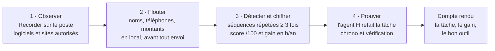

# Ghost : « See the work. Ghost the task. »
*Voir le travail. Faire disparaître la corvée.*

Team 14 · Hackathon Build The Future (Eugenia × H Company) · 16 au 20 novembre 2026 · Track Creative Entrepreneur

> **Ghost regarde le travail sur l'écran, trouve la tâche répétitive que plus personne ne voit, puis la fait faire par l'agent de H Company devant le client pour prouver le gain, chrono à l'appui.**

Cas de preuve : l'**Agence Belvédère** (fictive, Massy). Une assistante recopie chaque annonce sur **3 sites d'annonces sans passerelle** avec son logiciel. **12 minutes à la main. Moins de 2 minutes pour l'agent H, vérifié sur les 3 sites.**

*Membres de l'équipe : l'organisation interne (planning, branchements, règles de travail) est dans [`assel-ceo/organisation-equipe.md`](assel-ceo/organisation-equipe.md).*

*Back-end : qui fait quoi, où ça tourne, entrées et sorties de chaque brique, état réel : [`assel-ceo/backend-qui-fait-quoi.md`](assel-ceo/backend-qui-fait-quoi.md).*

---

## 1. Le problème

Dans une PME, les tâches répétitives sont **invisibles** : personne ne les chronomètre, donc personne ne les automatise. Un audit classique coûte 2 à 3 jours de consultant, repose sur ce que les gens *disent* faire, et finit souvent dans un tiroir.

Et les outils d'automatisation (n8n, Zapier) exigent une API. Or une grande partie du travail se fait dans des sites et des logiciels **sans API** : c'est exactement là qu'un agent qui utilise l'écran comme un humain devient utile.

## 2. La solution, en 4 temps



1. **Observer.** Le *Ghost Recorder* (Python, Mac et Windows) suit l'application au premier plan et ne capte **que** les logiciels et les sites cochés par le salarié. Ailleurs, il écrit un seul événement `hors_perimetre`, sans aucun contenu.
2. **Flouter.** Le texte de l'écran est lu en local (Apple Vision sur Mac, OCR Windows), puis les noms, téléphones, e-mails, adresses et montants sont remplacés (`[NOM]`, `[TELEPHONE]`…) **sur le poste, avant tout envoi** (règles du profil métier + spaCy français). L'image n'est jamais envoyée.
3. **Détecter et chiffrer.** Du code, sans IA, repère les séquences répétées au moins 3 fois et mesure leur durée. L'IA n'intervient qu'ensuite, sur 5 tâches candidates déjà nettoyées. Chaque tâche reçoit un score sur 100 et un gain en heures par an, avec ses hypothèses écrites.
4. **Prouver.** L'**Agent API de H Company** refait la tâche sur les vrais formulaires. La durée est mesurée par notre code, et la réussite est vérifiée **en relisant les sites, jamais d'après le texte de l'agent**.

Le compte rendu donne, pour chaque tâche, le bon outil : **API disponible → n8n. Pas d'API → agent H. Déjà couvert par le logiciel du client → rien à construire.**

## 3. Démo et résultats mesurés

**La tâche :** recopier une annonce sur 3 sites de test de difficulté croissante (formulaire simple ; autres noms de champs et menu déroulant ; 2 étapes avec case à cocher et envoi de photo).

| Mesure | Résultat | Source |
|---|---|---|
| Agent H sur le vrai mandat M-0142, 3 sites (`h/web-surfer-pro`) | **3 sur 3 vérifiés en 99 s** au lieu de 720 s à la main (**86 % de temps en moins**), **0,10 $** | session 633cebc0, table `executions_agent` |
| Premier passage sur les 3 sites | 3 sur 3 en 156 s, 0,19 $ | session 969ac9f2 |
| Cas démo, 10 essais **avant** la correction automatique | 6 sur 10, médiane 98 s, 0,11 $ par essai ; 4 faux succès (« lumine » au lieu de « lumineux »), d'où la correction automatique | `serie_tests.py`, table `tests_agent` |
| Annonce piégée sans classe énergie (M-T01) | **refusée 3 fois sur 3**, l'agent répond « signale » avec la raison, en 21 s | `serie_tests.py` |
| Annonce piégée à 484 €/m² (M-T02) | **refusée 3 fois sur 3**, en 20 s | `serie_tests.py` |
| Niveau 1 (1 site), 2 essais | 2 sur 2, médiane 30 s, 0,019 $ par essai | `alejandro-cto/agent-h/serie_tests.py` |
| `h/web-surfer-flash` | **faux succès** : titre reformulé, agent qui annonce « publié » | session 8f893be4 |
| Recorder sur Mac (MacBook Air) | Portails A, B et C captés ; Gmail et une recherche Google **non captés** ; noms et téléphone masqués | test du 17/11 |
| Gain chiffré de l'agence | **205 h/an** justifiées tâche par tâche (3 tâches) | `commun/donnees/taches-semaine-agence.json` |

*À venir : le taux de réussite sur 10 essais après la correction automatique (si une annonce est fausse, notre code dit à l'agent quel champ corriger, 2 relances au maximum).*

**Ce qui est réel, ce qui est simulé**

| Élément | Statut |
|---|---|
| Capture des logiciels autorisés, floutage local | **Réel, en live** |
| Détection de la tâche répétée | **Réel**, sur 2 sessions de 15 minutes jouées par l'équipe |
| Exécution par l'agent H, chrono | **Réel, en live**, sur nos 3 sites de test |
| L'agence, ses mandats, ses prospects | **Fictif**, aucune donnée réelle |
| Les 5 jours d'audit | **Simulé** : compressés en 2 sessions |
| Les 3 portails | **Sites de test** : jamais sur de vrais portails (conditions d'utilisation) |
| Gain annuel de l'agence | **Extrapolation**, hypothèses affichées |

## 4. Comment tester

| Quoi | Où |
|---|---|
| Les 3 sites de test | [Portail A](https://ghost-portail-a.vercel.app/deposer) · [Portail B](https://ghost-portail-b.vercel.app/nouvelle) · [Portail C](https://ghost-portail-c.vercel.app/publier) · page « Annonces publiées » sur chaque site |
| Le jeu de données fictif | [Hugging Face : Kudozin/ghost-agence-immobiliere-fictive](https://huggingface.co/datasets/Kudozin/ghost-agence-immobiliere-fictive) (8 sous-ensembles, dont les 23 phrases pièges du floutage et 2 mandats piégés) |

| Brique | Commande (depuis la racine) | Clés dans `.env` |
|---|---|---|
| Recorder | `cd alejandro-cto/recorder && pip install -r requirements.txt && python recorder.py` (`--console` pour le journal dans le terminal) | `SUPABASE_URL`, `SUPABASE_SERVICE_ROLE_KEY` (facultatif : sinon journal local) |
| Agent H sur les 3 sites | `cd alejandro-cto/agent-h && pip install -r requirements.txt && python lancer_agent.py --tache tache_001 --mandat M-0142` (`--mandat M-T01` pour une annonce piégée) | `HAI_API_KEY` |
| Floutage et détection | `PYTHONPATH=omar-caio python -m pytest omar-caio/tests -q` | aucune |
| Score et gain | `cd henriquet-cdo/scoring && python -m pytest -q` | aucune |
| Sites de test en local | `cd vladimir-cao/portails && npm install && npm run dev:a` (`dev:b`, `dev:c`) | `SUPABASE_URL`, `SUPABASE_SERVICE_ROLE_KEY` (sinon mode mémoire) |
| Interface | `cd binta-cpo/app/ghost-ui && npm install && npm run dev` | aucune |
| Base | coller `commun/schema-supabase.sql`, puis les fichiers de `henriquet-cdo/supabase/` | - |

**Permissions macOS pour le Recorder** (Réglages Système › Confidentialité et sécurité, pour Terminal) : Enregistrement de l'écran, Accessibilité, Automatisation › Google Chrome. Quitter et rouvrir Terminal après l'Enregistrement de l'écran.

## 5. Tests

| Brique | Commande | Résultat |
|---|---|---|
| Recorder | `cd alejandro-cto/recorder && python -m pytest tests -q` | **19 passés** |
| Floutage et détection | `PYTHONPATH=omar-caio python -m pytest omar-caio/tests -q` | **50 passés** |
| Score et gain | `cd henriquet-cdo/scoring && python -m pytest -q` | **8 passés** |
| Série de tests de l'agent H | `cd alejandro-cto/agent-h && python -m pytest tests -q` | **7 passés** |
| Sites de test et interface | `npx next build` | compilent |

Les tests ne demandent aucune clé API. À chaque push, GitHub Actions lance les tests du Recorder, du floutage et de la détection, et compile les deux applications Next.js (onglet **Actions**).

## 6. Ce que le jury évalue, et ce qu'on montre

| Critère | Poids | Ce qu'on montre |
|---|---|---|
| **Excellence technique et Agents API** | 30 % | L'agent H en live sur 3 sites de difficulté croissante, réponse structurée (`answer_schema`), limites d'étapes et de temps, résultat vérifié dans les sites, correction automatique, contrôle avant publication (annonces piégées refusées), taux de réussite mesuré, comparaison flash / pro |
| **Pertinence et impact** | 25 % | Un problème chiffré (12 min par annonce), un gain mesuré (99 s au lieu de 720 s), une formule du gain avec ses hypothèses écrites (205 h/an) |
| **Faisabilité, adoption, apprentissages** | 25 % | Conformité dès la conception (périmètre choisi par le salarié, floutage local, pas de suivi des personnes), coût de run chiffré, transparence sur le simulé, retours honnêtes sur l'Agent API |
| **UX, démo et pitch** | 20 % | Icône visible et pause, journal « ce qui a été capté » avant et après floutage, tableau de bord, rapport et preuve chronométrée |

## 7. Pourquoi ça tient : le ROI

| | Audit par un consultant | Agent computer use seul | **Ghost** |
|---|---|---|---|
| Quelles tâches automatiser ? | entretiens : ce que les gens *disent* faire | il faut déjà le savoir | **mesuré sur l'écran** : ce que les gens *font* |
| Coût de l'audit | 2 à 3 jours de consultant | - | une semaine d'observation automatique |
| Preuve du gain | estimation | - | **la tâche exécutée devant le client, chronométrée** |
| Choix de l'outil | au cas par cas | toujours l'agent | **n8n si API, agent H sinon, rien si déjà couvert** |
| Vie privée | entretiens nominatifs | - | périmètre choisi par le salarié, floutage local, le gérant voit des tâches, jamais des personnes |

Une passe de l'agent sur les 3 sites coûte **0,10 $**, contre environ 12 minutes d'assistante par annonce.

## 8. Les outils, et ce que chacun fait vraiment

| Outil | Rôle dans Ghost | Où dans le code |
|---|---|---|
| **H Company · Agent API** (`hai-agents`) | exécute la tâche dans un navigateur hébergé à partir des vrais mandats, réponse structurée, limites d'étapes et de temps, correction automatique, contrôle avant publication ; `web-surfer-pro` retenu après le faux succès de `flash` | `alejandro-cto/agent-h/lancer_agent.py`, `serie_tests.py` |
| **H Company · Holo** | analyse des 5 tâches candidates (prompts en 3 couches : métier, entreprise, poste) ; Claude possible en option | `omar-caio/detection/provider_holo.py` |
| **Hugging Face** | publication du jeu de données fictif (mandats dont 2 piégés, semaine type, scores, 23 phrases pièges du floutage) | `henriquet-cdo/huggingface/` |
| **spaCy (modèle français)** | reconnaissance des noms en local, avant tout envoi | `omar-caio/filtres/nettoyage.py` |
| **Supabase** | événements, tâches, scores, résultats de l'agent, annonces des sites de test ; schéma pensé pour supprimer tout un audit en cascade | `commun/schema-supabase.sql`, `henriquet-cdo/supabase/` |
| **Next.js sur Vercel** | les 3 sites de test et l'interface (tableau de bord, rapport) | `vladimir-cao/portails/`, `binta-cpo/app/ghost-ui/` |
| **n8n** | les tâches qui ont une API, par exemple l'alerte J2 : un e-mail au salarié dès qu'une tâche est détectée, sans doublon ni alerte perdue | `vladimir-cao/n8n/` |
| **GitHub** | dépôt de l'équipe, une branche par rôle, vérifications automatiques à chaque PR | `.github/workflows/verifications.yml` |

## 9. Conformité et sécurité

- **Le salarié choisit** les logiciels et les sites observés. Chrome coché sans site = rien n'est capté. Navigation privée : jamais captée.
- **Floutage sur le poste**, avant tout envoi. L'image n'est jamais envoyée, seul le texte nettoyé part. L'adresse est enregistrée sans ses paramètres.
- **Le gérant voit des tâches, jamais des personnes** (pas de répartition par personne sous 3 participants). Ghost est pensé comme le contre-modèle de la sanction CNIL de 2024 dans l'immobilier.
- **Aucun secret dans le dépôt** : clés dans des fichiers `.env`, ignorés par Git. La clé « service » de Supabase reste côté serveur.
- **Données fictives uniquement**, agence comprise.
- Chaque session de l'agent a une **limite d'étapes et de durée**, et son résultat est **vérifié dans les sites**.

## 10. Limites et suite

**Limites assumées :** 5 jours d'audit compressés en 2 sessions ; sites de test au lieu de vrais portails ; gain extrapolé à partir d'hypothèses à chronométrer pendant un vrai audit ; floutage heuristique (pas une anonymisation garantie) ; profils comptable et avocat chargés mais pas encore testés.

**La suite, par ordre de priorité :**
1. **Mode vocal**, pour ceux qui refusent la capture : le salarié raconte sa journée, Ghost en tire les tâches.
2. **Skill H et agent sur mesure** : les consignes générées par l'audit deviennent une Skill H relue par le client, au lieu d'un texte de consigne.
3. **Benchmark** : agent avec une consigne simple contre agent avec la Skill et les règles, sur les mêmes annonces piégées.
4. **Script compilé** : une fois prouvée, la tâche devient un script qui ne consomme plus de tokens ; l'agent ne reprend la main que si le site change.
5. **Suivi du gain réel** après la mise en place, et mode 100 % local avec Holo pour les professions soumises au secret.

## 11. Le dépôt

```
README.md                     ← cette fiche projet
assel-ceo/                    ← organisation de l'équipe, journal des décisions, questions pour H
commun/                       ← partagé : contrats (formats communs), schéma Supabase, données fictives, roadmap
alejandro-cto/  recorder/     ← Ghost Recorder (capture des fenêtres autorisées, Mac et Windows)
                agent-h/      ← lancement de l'agent H, vérification sur les sites, série de tests
omar-caio/      filtres/      ← floutage local nettoyer()
                detection/    ← séquences répétées, prompts en 3 couches, analyse
                vocal/        ← prompts du mode vocal (prévu en complément)
vladimir-cao/   portails/     ← les 3 sites de test A, B, C (Next.js)
                n8n/          ← workflow de l'alerte J2 (tâche détectée → e-mail au salarié)
henriquet-cdo/  supabase/     ← données de départ, purge, test de connexion
                donnees/      ← agence Belvédère fictive (mandats, prospects)
                scoring/      ← score sur 100 et calcul du gain
                huggingface/  ← jeu de données publié sur Hugging Face
binta-cpo/      app/ghost-ui/ ← interface Next.js (tableau de bord, rapport)
                app/maquette/ ← maquette des écrans de démo
                pitch/        ← formulaire, fiche opportunité
```

## 12. Lexique

| Mot | Ce que c'est |
|---|---|
| **Recorder** | l'application qui observe l'écran, seulement dans le périmètre autorisé |
| **Événement** | une capture : appli, titre, adresse sans paramètres, texte flouté, durée |
| **`hors_perimetre`** | événement sans aucun contenu, écrit quand le salarié sort du périmètre |
| **Tâche détectée** | une séquence d'actions répétée au moins 3 fois |
| **Score** | note sur 100 qui combine gain, facilité, effort, risque et confiance |
| **Fiche opportunité** | la page du rapport consacrée à une tâche : gain, outil conseillé, preuve |
| **Preuve** | l'exécution de la tâche par l'agent H, chronométrée et vérifiée dans les sites |

## 13. L'équipe

| Rôle | Personne | Responsable de |
|---|---|---|
| CEO | Assel | décisions, pitch, checkpoints, retours sur l'Agent API, coût et go-to-market |
| CTO | Alejandro | Recorder, agent H, démo live |
| CAO | Vladimir | 3 sites de test, workflows n8n, séries de tests de l'agent |
| CAIO | Omar | floutage, détection des tâches, prompts |
| CDO | Henriquet | base Supabase, données fictives, score et gain, jeu de données Hugging Face |
| CPO | Binta | parcours et maquettes, interface, deck |
