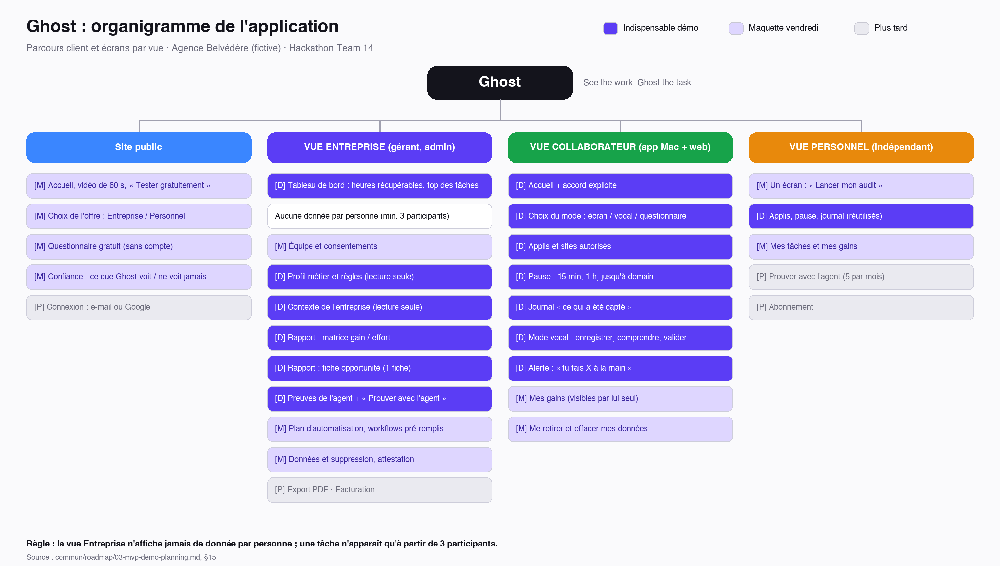

# Organigramme de l'application Ghost et écrans de démo

Source : `commun/roadmap/03`, §15. Légende : **[D]** indispensable pour la démo · **[M]** maquette vendredi · **[P]** plus tard.

Version code (Mermaid) :

```mermaid
flowchart TD
  G[Ghost]
  G --> SP[Site public]
  G --> CX[Connexion - P]
  G --> VE[VUE ENTREPRISE - gérant]
  G --> VC[VUE COLLABORATEUR - app Mac + page web]
  G --> VP[VUE PERSONNEL - indépendant]

  SP --> SP1[Accueil, vidéo 60 s - M]
  SP --> SP2[Choix offre Entreprise / Personnel - M]
  SP --> SP3[Questionnaire gratuit - M]
  SP --> SP4[Confiance : ce que Ghost voit / ne voit jamais - M]

  VE --> E1[Tableau de bord - D]
  VE --> E2[Équipe et consentements - M]
  VE --> E3[Profil métier et règles - D, lecture seule]
  VE --> E4[Contexte entreprise - D, lecture seule]
  VE --> E5[Rapports]
  E5 --> E5a[Synthèse : matrice gain / effort - D]
  E5 --> E5b[Fiche opportunité - D, 1 fiche]
  E5 --> E5c[Export PDF - P]
  VE --> E6[Preuves de l'agent + bouton Prouver - D]
  VE --> E7[Plan d'automatisation - M]
  VE --> E8[Facturation - P]
  VE --> E9[Données et suppression - M]

  VC --> C1[Accueil + accord explicite - D]
  VC --> C2[Choix du mode : écran / vocal / questionnaire - D]
  VC --> C3[Applis et sites autorisés - D]
  VC --> C4[Pause 15 min / 1 h / demain - D]
  VC --> C5[Journal : ce qui a été capté - D]
  VC --> C6[Mode vocal : enregistrer, comprendre, valider - D]
  VC --> C7[Alerte : tu fais X à la main - D]
  VC --> C8[Mes gains, visibles par lui seul - M]
  VC --> C9[Me retirer et effacer mes données - M]

  VP --> P1[Un écran : Lancer mon audit - M]
  VP --> P2[Applis, pause, journal : réutilisés - D]
  VP --> P3[Mes tâches et gains - M]
  VP --> P4[Prouver avec l'agent, 5 par mois - P]
  VP --> P5[Abonnement - P]
```

## Règle de confidentialité (affichage)
- La vue Entreprise n'affiche **jamais** de donnée par personne.
- Une tâche apparaît toujours (sinon la tâche de démo, faite par l'assistante seule, serait cachée). Mais si **moins de 3 personnes** la font, aucune répartition ni aucun chiffre par personne n'est affiché : seulement la tâche, son temps total et l'outil recommandé.

## Écrans à maquetter, dans l'ordre de la démo (4 min)
| # | Écran | Vue | Moment démo | Contenu minimal |
|---|---|---|---|---|
| 1 | Autorisations | Collaborateur | 0:25 | Cases Chrome (4 sites) + tableur, icône colorée / barrée |
| 2 | Journal « ce qui a été capté » | Collaborateur | 0:55 | Texte avant / après floutage, suppression ligne par ligne |
| 3 | Tableau de bord | Entreprise | 1:20 | Heures récupérables (205 h/an), tâches classées, matrice gain / effort |
| 4 | Preuve de l'agent | Entreprise | 1:50 | Bouton « Prouver avec l'agent », chrono, 3 sites publiés |
| 5 | Rapport : fiche opportunité | Entreprise | 3:30 | 2 axes (métier / technique), durée avant / après, score 73/100 |
| 6 | Mode vocal | Collaborateur | mercredi | Enregistrer → « voici ce que j'ai compris » → valider / corriger |
| 7 | Alerte J2 | Collaborateur | 3:30 | 1 alerte « tu fais X à la main » |

## Parcours en 30 secondes (test « quelqu'un d'extérieur »)
Autoriser quelques sites → Ghost observe → le gérant voit les tâches (pas les personnes) → l'agent prouve le gain → rapport avec plan d'action.
