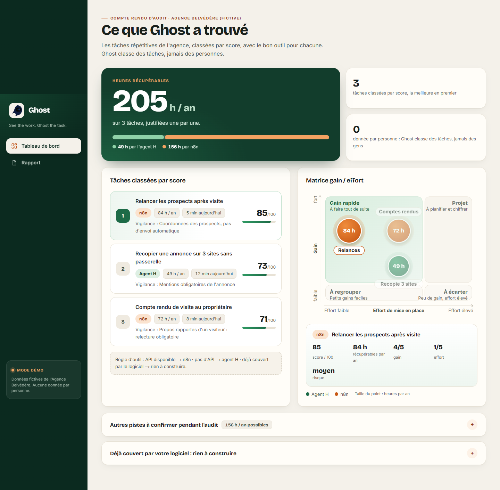

# Charte graphique Ghost (v2)

Vert forêt, blanc cassé, orange. Pensée pour un écran projeté et lisible par tous (contrastes mesurés, voir plus bas).
Les valeurs vivent dans `binta-cpo/app/ghost-ui/app/globals.css` (variables CSS) : ce document les explique, le CSS fait foi.



## 1. Ce que l'interface doit dire

Ghost regarde le travail répétitif, le classe et le prouve. L'interface sert ce message dans cet ordre :

1. **Un chiffre d'abord.** « 205 h / an récupérables » est la première chose vue. Tout le reste le justifie.
2. **La preuve est le moment fort.** Le bouton « Prouver avec l'agent » et le duel « 12 min à la main contre l'agent » sont l'élément dont on doit se souvenir. C'est là qu'on met l'orange.
3. **Des tâches, jamais des personnes.** Aucune donnée par personne n'est affichée, et l'interface le dit.
4. **Une couleur, un sens.** Vert = marque et agent H. Orange = n8n et l'action principale. Ocre = vigilance. Jamais la couleur seule : toujours un mot à côté (pastille, légende).
5. **Le détail à la demande.** Les pistes secondaires sont repliées, le détail d'une tâche s'affiche au survol ou au clavier.

## 2. Logo

Fantôme bleu nuit, visière noire, deux yeux. Fichier vectoriel : [`logo-ghost.svg`](logo-ghost.svg). Dans l'application : `app/logo.tsx` (composant `GhostMark`).

| Règle | Détail |
|---|---|
| Où | **Une seule fois par écran** : en haut de la barre latérale. Pas de filigrane, pas de répétition. |
| Fond | Posé sur une tuile blanc cassé (`#F4F1EA`), arrondie à 14 px, jamais directement sur le vert foncé. |
| Taille | 34 px dans une tuile de 44 px (36 px sur téléphone). Minimum 24 px. |
| Couleurs du logo | Corps `#0D1B3E`, visière `#050608`, yeux `#24407F`. Le bleu nuit est réservé au logo. |
| Mot « Ghost » | Bricolage Grotesque 800, blanc sur la barre latérale. |
| Signature | « See the work. Ghost the task. » sous le logo, en petit. |

## 3. Couleurs

### Rôles

| Rôle | Variable | Valeur | Usage |
|---|---|---|---|
| Fond de page | `--bg` | `#F4F1EA` | Blanc cassé, toute la page |
| Surface | `--card` | `#FFFDF8` | Cartes |
| Texte | `--ink` | `#18201B` | Texte principal |
| Texte secondaire | `--ink-2` | `#45514A` | Paragraphes, légendes |
| Texte discret | `--mute` | `#5C655D` | Libellés, notes |
| Filets | `--line` / `--line-2` | `#E8E2D6` / `#D4CCBD` | Bordures, séparateurs |
| Marque | `--g-700` | `#1D6B47` | Liens, scores, agent H, étapes |
| Marque sombre | `--g-900` / `--g-950` | `#123D2C` / `#0B2A1F` | Grand bloc, en-tête du rapport, barre latérale |
| Vert clair | `--g-500` / `--g-300` | `#2E9A63` / `#8FD1A8` | Barres de score, part agent H |
| Teintes vertes | `--g-100` / `--g-50` | `#DDEFE3` / `#EEF6F0` | Pastille agent H, zone « gain rapide » |
| Action et n8n | `--o-600` | `#C25418` | Bouton principal, numéros de section, n8n |
| Orange sombre | `--o-700` | `#9A4212` | Texte orange sur fond clair (sur-titres, pastille n8n) |
| Orange clair | `--o-400` | `#F4A261` | Chiffres et libellés orange sur fond vert foncé |
| Teintes orange | `--o-100` / `--o-50` | `#FBE3CF` / `#FDF2E7` | Pastille n8n, carte « Preuve » |
| Vigilance | `--ochre-700` / `--ochre-50` | `#86590B` / `#F8EED3` | Points de vigilance, pastille « hypothèse » |
| Logo | `--navy` | `#0D1B3E` | Logo seulement |

### Règles

- **L'orange est rare.** Un seul bouton orange par écran : l'action principale. Le reste de l'orange sert à n8n et aux repères (sur-titres, numéros de section).
- **Le vert foncé porte les chiffres forts** : grand bloc du tableau de bord, en-tête du rapport.
- **Pas de dégradés décoratifs** sur les cartes. Une seule lueur légère est permise sur le grand bloc vert.
- **Pas de violet ni d'indigo** (l'ancienne couleur n8n de la v1 est remplacée par l'orange).

### Contrastes mesurés (WCAG, minimum 4,5:1 pour le texte courant)

| Texte | Fond | Contraste |
|---|---|---|
| Encre `#18201B` | Fond `#F4F1EA` | 14,8:1 |
| Texte secondaire `#45514A` | Fond `#F4F1EA` | 7,4:1 |
| Texte discret `#5C655D` | Fond `#F4F1EA` | 5,4:1 |
| Vert marque `#1D6B47` | Fond `#F4F1EA` | 5,7:1 |
| Blanc | Vert marque `#1D6B47` | 6,5:1 |
| Blanc | Vert sombre `#123D2C` | 12,1:1 |
| Blanc (bouton) | Orange `#C25418` | 4,6:1 |
| Orange sombre `#9A4212` | Teinte `#FBE3CF` | 5,4:1 |
| Ocre `#86590B` | Teinte `#F8EED3` | 5,3:1 |

À ne pas faire : du texte orange `#F4A261` sur fond clair (trop pâle), ou du texte gris plus clair que `#5C655D`.

## 4. Typographie

| Usage | Police | Graisse | Taille |
|---|---|---|---|
| Titres, chiffres, boutons | **Bricolage Grotesque** | 600 à 800 | H1 2 à 3,1 em · H2 1,18 em · titres de section 1,7 em |
| Grand chiffre | Bricolage Grotesque | 800 | 3,6 à 6,6 em, interlettrage serré (-0,05 em) |
| Texte courant | **Inter** | 400 à 600 | 15 à 19 px (grandit avec l'écran) |
| Sur-titres, libellés | Bricolage Grotesque | 700 | 0,76 em, capitales, espacées, précédées d'un trait orange |

- Deux polices, pas plus.
- Chiffres alignés (`tabular-nums`) partout où l'on compare des nombres.
- **Rien sous 12 px à l'écran**, y compris dans les graphiques (le texte de la matrice fait 13 à 14 px affichés).

## 5. Mise en page

```
┌──────────┬──────────────────────────────────────────────┐
│  Logo    │  Sur-titre                                   │
│  Ghost   │  Titre de la page                            │
│          │  ┌─────────────────────────┐ ┌────────────┐  │
│ Tableau  │  │ 205 h / an  (vert foncé) │ │ 3 tâches   │  │
│ Rapport  │  │ barre agent H / n8n      │ ├────────────┤  │
│          │  └─────────────────────────┘ │ 0 donnée   │  │
│          │                              └────────────┘  │
│          │  ┌──────────────────┐ ┌──────────────────┐   │
│ Mode     │  │ Tâches classées  │ │ Matrice          │   │
│ démo     │  └──────────────────┘ └──────────────────┘   │
│          │  [ Pistes à confirmer           + ]          │
└──────────┴──────────────────────────────────────────────┘
```

- **Barre latérale** vert foncé de 252 px : logo, navigation (icône + mot), mention « Mode démo » en bas. Sous 900 px, elle devient une barre en haut.
- **Contenu** limité à 1 480 px de large, marges de 40 px (16 px sur téléphone).
- **Grilles** : écart de 16 à 20 px entre les cartes. Sur téléphone, une colonne, et les chiffres clés sur deux colonnes.
- **Rayons** : cartes 18 px, grand bloc 22 px, boutons 14 px, pastilles arrondies.
- **Ombres** : très légères au repos, un peu plus marquées au survol.

## 6. Composants

| Composant | Règle |
|---|---|
| **Grand bloc** | Fond `--g-900`, libellé orange clair, chiffre blanc, barre répartie vert clair (agent H) / orange clair (n8n) avec sa légende. |
| **Chiffres clés** | Cartes blanches : un chiffre en gras, une phrase qui dit quelque chose de vrai. Pas d'icône décorative. |
| **Liste classée** | Rang dans une tuile (le n°1 en vert plein), nom, pastilles (outil, heures, durée), score sur 100 avec sa barre. Soulèvement de 2 px au survol. |
| **Matrice gain / effort** | Zone « gain rapide » teintée de vert, taille du point = heures, couleur = outil, nom de la tâche écrit à côté. Le détail s'affiche au survol et au clavier. |
| **Pastilles** | Agent H : vert clair / vert foncé. n8n : orange clair / orange sombre. Rien à construire : beige / gris. |
| **Bouton principal** | Orange `--o-600`, texte blanc, monte de 1 px au survol, s'enfonce au clic. Le bouton secondaire est un contour. |
| **Sections repliables** | Rond « + » orange fermé, « − » vert ouvert. |
| **Rapport** | En-tête vert foncé (anneau de score, phrase clé, 4 chiffres), sections numérotées en orange (Métier, Technique, Preuve), encadrés vert (gain), orange (à vérifier), ocre (vigilance). |
| **Preuve de l'agent** | Carte teintée orange : les 3 sites passent au vert un par un, puis le gain en % et la comparaison « à la main » (orange) / « agent H » (vert). |

## 7. Mouvement

- Survol : cartes et lignes montent de 2 px, liens soulignés par un trait orange qui se dessine.
- Durées courtes (0,15 à 0,25 s), aucune animation en boucle.
- Si l'utilisateur demande moins d'animations (réglage du système), tout s'arrête.

## 8. Accessibilité (vérifié le 18/11)

- Contrastes : tous les textes au-dessus de 4,5:1 (tableau en section 3).
- Focus clavier visible partout (contour orange de 3 px).
- La couleur n'est jamais seule : pastilles écrites, légendes, détail de la matrice.
- Pas de défilement horizontal sur téléphone (vérifié à 390 px).

## 9. À faire

- **Mode sombre** : pas fait. Les directives d'Apple demandent les deux apparences ; pour une démo projetée, le clair suffit.
- **Matrice** : la couleur reste le principal repère de l'outil sur les points eux-mêmes (la légende et le détail l'écrivent). Une forme différente par outil serait plus sûre.
- **Icône d'onglet** (favicon) : à créer à partir du logo.
