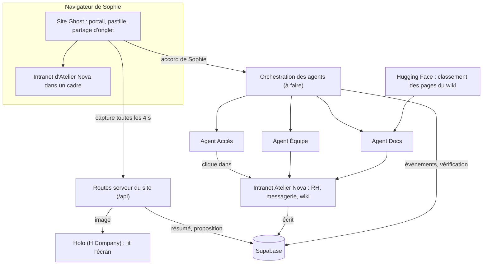

# Architecture

Deux déploiements Vercel distincts et une base Supabase commune.

## Principes

- **Les images ne sont jamais conservées** : seul le résumé texte de Holo est enregistré.
- **Le navigateur ne lit rien directement** dans la base, sauf `profils` et `abonnements` de la personne connectée. Tout le reste passe par des routes serveur avec la clé de service.
- **Une action n'est comptée que si elle est vérifiée** : la vue `v_onboarding` contrôle les 9 éléments d'une arrivée (fiche, accès, badge, canal, message, parrain, café, page wiki, checklist).
- **Ghost ne propose que si Holo voit l'arrivée ET si la base a une arrivée « nouvelle »** : une erreur de lecture ne déclenche jamais rien seule.
- **Avant une action irréversible** (commande de matériel), l'agent attend une validation humaine ; si une information manque (manager), il pose la question.

## Tables principales (voir `supabase/schema.sql`)

`profils`, `abonnements` · `personnes`, `arrivees`, `rh_*`, `msg_*`, `wiki_*` (intranet) · `sessions_audit`, `consentements`, `captures_lues`, `taches_detectees`, `propositions` (observation) · `agents_runs`, `agents_evenements`, `decisions_humaines` (agents).
